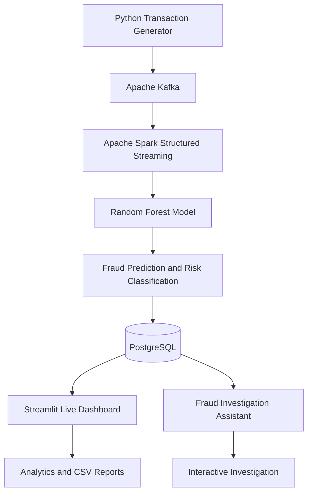

# Real-Time AI Fraud Detection System

An end-to-end real-time banking fraud detection platform
built using Apache Kafka, Apache Spark Structured Streaming,
Machine Learning, PostgreSQL, Docker, and Streamlit.

## Project Overview

This project simulates a banking transaction processing
system that ingests financial transactions in real time,
applies machine learning-based fraud detection, stores
predictions in PostgreSQL, and provides an interactive
dashboard for fraud monitoring and investigation.

## Business Objectives

- Process banking transactions in real time.
- Identify potentially fraudulent transactions.
- Classify transactions by risk level.
- Monitor suspicious financial activity.
- Enable interactive fraud investigations.
- Maintain transaction data quality.
- Automate system validation using Pytest.

## System Architecture



## Technology Stack

| Technology | Purpose |
|---|---|
| Python 3.11 | Application development |
| Apache Kafka 3.9.1 | Real-time event ingestion |
| Apache Spark 3.5.5 | Distributed stream processing |
| Scikit-learn | Machine learning |
| Random Forest | Fraud classification |
| PostgreSQL 16 | Transaction storage |
| Docker | Containerization |
| Docker Compose | Infrastructure management |
| Streamlit | Interactive dashboard |
| Plotly | Data visualization |
| Pandas | Data analysis |
| Joblib | Model serialization |
| Pytest | Automated testing |
| Python-dotenv | Environment configuration |

## Key Features

### Real-Time Data Engineering

- Continuous synthetic banking transaction generation.
- Kafka-based event ingestion.
- Customer-based message partitioning.
- Spark Structured Streaming processing.
- JSON transaction processing.
- PostgreSQL persistence.
- Transaction uniqueness and data quality validation.

### Machine Learning

- Random Forest binary classification.
- Training on 20,000 synthetic transactions.
- Categorical feature encoding.
- Stratified training and testing split.
- Fraud probability estimation.
- HIGH, MEDIUM and LOW risk classification.
- Serialized model for streaming inference.
- Handling previously unseen categorical values.

### Interactive Dashboard

- Live transaction monitoring.
- Total transaction and fraud KPIs.
- Fraud flag rate.
- Potential financial exposure.
- Transaction trends.
- Geographic fraud analysis.
- Merchant category analysis.
- Recent suspicious transactions.
- Machine learning performance metrics.
- Risk and location filters.
- Automatic dashboard refresh.
- CSV report export.

### Fraud Investigation Assistant

A rule-based conversational investigation interface
that allows users to explore stored transaction data.

Supported investigations include:

- Overall fraud summary.
- Top suspicious transactions.
- Fraud by geographic location.
- Potential financial exposure.
- Customer-specific investigations.

The assistant uses rule-based query handling rather
than an external large language model.

## Project Structure

```text
real-time-fraud-detection-ai/
|
|-- config/
|-- data/
|-- models/
|-- reports/
|-- tests/
|   |-- test_database.py
|   |-- test_data_quality.py
|   |-- test_fraud_model.py
|   |-- test_producer.py
|
|-- ai_assistant.py
|-- dashboard.py
|-- database.py
|-- fraud_model.py
|-- producer.py
|-- stream_processor.py
|-- docker-compose.yml
|-- Dockerfile.spark
|-- requirements.txt
|-- .env.example
|-- .gitignore
|-- README.md
```

Generated datasets and model artifacts are excluded
from version control and recreated during setup.

## Installation and Setup

### Prerequisites

- Python 3.11
- Docker Desktop
- Docker Compose
- Git
- Internet access for dependencies and Spark packages

The following commands are intended for Windows CMD.

### 1. Clone the Repository

```cmd
git clone https://github.com/palvp1/real-time-fraud-detection-ai.git
cd real-time-fraud-detection-ai
```

### 2. Create a Virtual Environment

```cmd
python -m venv .venv
.venv\Scripts\activate
pip install -r requirements.txt
```

For serialized model compatibility, use the same
machine learning dependency versions as Dockerfile.spark.

### 3. Configure Environment Variables

```cmd
copy .env.example .env
```

Update the database password inside .env.

```env
DB_HOST=127.0.0.1
DB_PORT=5433
DB_NAME=fraud_detection
DB_USER=fraud_user
DB_PASSWORD=your_database_password
```

Never commit the actual .env file to GitHub.

### 4. Start Kafka and PostgreSQL

```cmd
docker compose up -d
```

Verify the containers:

```cmd
docker ps
```

### 5. Create the Kafka Topic

```cmd
docker exec fraud-kafka /opt/kafka/bin/kafka-topics.sh --create --if-not-exists --topic banking-transactions --bootstrap-server localhost:9092 --partitions 3 --replication-factor 1
```

### 6. Build the Spark Docker Image

```cmd
docker build -f Dockerfile.spark -t fraud-spark-ml:1.0 .
```

### 7. Train the Machine Learning Model

Train inside the Spark image to maintain dependency
compatibility between training and streaming inference.

```cmd
docker run --rm -v "%cd%:/app" fraud-spark-ml:1.0 python fraud_model.py
```

This generates:

- data/training_transactions.csv
- models/fraud_model.pkl

### 8. Start the Transaction Producer

Open a separate CMD terminal, activate the virtual
environment, and run:

```cmd
python producer.py
```

### 9. Start Spark Streaming

Open another CMD terminal in the project directory.

```cmd
docker run --rm --network real-time-fraud-detection-ai_default --env-file .env -e DB_HOST=fraud-postgres -e DB_PORT=5432 -v "%cd%:/app" fraud-spark-ml:1.0 spark-submit --packages org.apache.spark:spark-sql-kafka-0-10_2.12:3.5.3 stream_processor.py
```

The Kafka connector version above reflects the
configuration used during the working demonstration.

### 10. Launch the Dashboard

Open another CMD terminal and activate the virtual
environment.

```cmd
streamlit run dashboard.py
```

Open the dashboard at:

http://localhost:8501

## Database Validation

Test PostgreSQL connectivity:

```cmd
python database.py
```

Inspect stored transaction counts:

```cmd
docker exec fraud-postgres psql -U fraud_user -d fraud_detection -c "SELECT COUNT(*) FROM fraud_transactions;"
```

## Automated Testing

Run the test suite after training the model and
processing transactions into PostgreSQL.

```cmd
python -m pytest tests -v
```

### Verified Test Results

| Test Suite | Passed |
|---|---:|
| Database Integration | 4 |
| Data Quality | 6 |
| Machine Learning | 9 |
| Transaction Generation | 14 |
| Total | 33 |

Recorded execution result:

```text
33 passed in 4.68s
```

The investigation assistant was also manually tested.

## Demonstration Results

A recorded validation snapshot contained:

| Metric | Result |
|---|---:|
| Total transactions | 4,142 |
| Legitimate transactions | 3,935 |
| Fraudulent transactions | 207 |
| False positives | 0 |
| False negatives | 0 |
| Synthetic classification accuracy | 100% |
| Synthetic precision | 100% |
| Synthetic recall | 100% |
| Synthetic F1 score | 100% |

A separate duplicate validation snapshot confirmed
4,012 unique transactions and zero duplicate records.

All six automated data quality checks passed.

## Security and Configuration

- Database credentials managed using environment variables.
- Private environment files excluded from Git.
- Kafka and PostgreSQL host ports bound to localhost.
- Persistent Docker volumes for Kafka and PostgreSQL.
- Synthetic data used instead of actual customer information.

## Limitations

This project is a portfolio demonstration and is not
intended for production financial decision-making.

- Training and streaming data are synthetic.
- Fraudulent and legitimate transaction amount ranges
  do not overlap, making classification unusually easy.
- Demonstration accuracy does not represent real-world
  fraud detection performance.
- Kafka uses a single-broker development configuration.
- Durable streaming recovery and exactly-once processing
  have not been fully validated.
- The investigation assistant is rule-based.
- Production authentication, encryption and access controls
  would require additional implementation.

## Future Enhancements

- Realistic fraud patterns and overlapping transaction amounts.
- Independent fraud detection evaluation datasets.
- Durable Spark checkpoints.
- Dead-letter queues for invalid events.
- Model drift monitoring.
- MLflow model lifecycle management.
- Prometheus and Grafana monitoring.
- Cloud deployment.
- CI/CD automated testing.
- LLM-powered investigation capabilities.

## Author

Ajay Madinni

Data Engineering | Streaming Analytics | Machine Learning

GitHub:
https://github.com/ajay-madinni-DE

LinkedIn:
https://www.linkedin.com/in/ajay-m-9b5a9b3b4/

Portfolio:
https://ajay-madinni-de.github.io/data-engineering-portfolio/

---

Built as an end-to-end data engineering and machine
learning portfolio project demonstrating real-time
financial transaction processing and fraud analytics.
